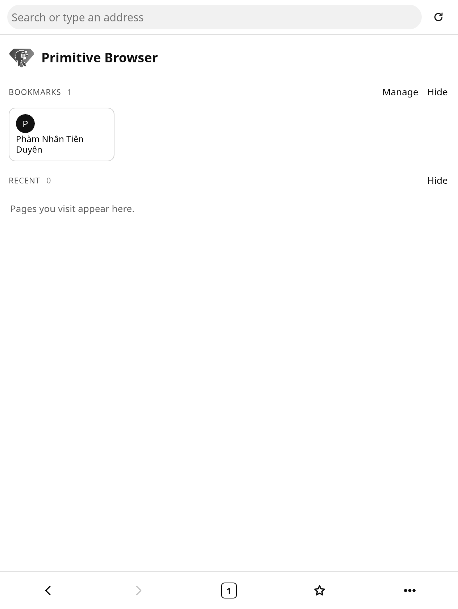

# Primitive Browser

[](https://github.com/OWNER/REPO/actions/workflows/ci.yml)
[](https://github.com/OWNER/REPO/releases)
[](https://github.com/OWNER/REPO/tags)
[](https://github.com/OWNER/REPO/stargazers)
[](#licence)

> The badges use the placeholders `OWNER/REPO`. Replace them with the GitHub repository once it
> exists. The CI badge shows the status of the `main` branch.

**A native web browser for jailbroken Kindle e-readers, written in Rust.** Pages are laid out by the
[Blitz](https://github.com/DioxusLabs/blitz) HTML/CSS engine, run a JavaScript subset in QuickJS, and
are painted in 8-bit grayscale for e-ink. The browser runs on the Kindle itself. No computer or
rendering server is needed while browsing.



| Keyboard | Reading view | Quick settings |
|---|---|---|
|  |  |  |

*Screenshots come from the desktop build of the same engine. The quick settings preview shows the
desktop placeholder values, not a real battery.*

## Status

| Device | Status |
|---|---|
| Kindle Oasis 3 (1264 × 1680, firmware 5.18.2) | Verified on hardware |
| Other Kindle models | Not supported yet. See [device support](docs/DEVICES.md) for the plan. |

Current version: **0.1.17** (workspace version, untagged). Versioning and tags are described in
[versioning](docs/VERSIONING.md). Hardware observations are in [device notes](docs/device-notes.md).

## Features

| Area | What it does |
|---|---|
| Rendering | HTML and CSS with flexbox and grid. Page layout width is selectable: 412, 600 or 800 CSS px (default 600). |
| Networking | HTTPS with bundled TLS roots, redirects, six parallel sub-resources, images loaded after the text. |
| Navigation | Links and section links. Back and Forward restore the scroll position. One previous page is kept live for instant Back. |
| Tabs | New, switch and close. Each tab keeps its own history and scroll position. Tabs resume after a restart. |
| Input | An on-screen keyboard with caret, Shift, symbols and address suggestions. Basic text-field forms (GET and POST). |
| Reading | A reading view, text size from 80% to 200%, page width, day and night, and an images switch. |
| Library | Bookmarks with reorder and remove, recent visits, saved HTML pages, and folding Home sections. |
| Storage | HTTP cookies, a 200 MiB disk cache with offline fallback, and persistent display settings. |
| Device | Quick settings from the top edge (frontlight, warmth, battery, Wi-Fi, clock), page-turn buttons, and a launcher that restores the Kindle when the browser exits. |

## Limits

The JavaScript runtime is a subset of the browser APIs. There is no ES modules, XMLHttpRequest,
WebSockets, workers, canvas, WebGL, audio or video, and fetch blocks underneath its Promise. Web
storage is in-memory. Modern web apps will not work. See [requirements](docs/01-requirements.md).

## Install (no build needed)

Download the release package from the [Releases](https://github.com/OWNER/REPO/releases) page, check
its checksum, and copy it onto the Kindle over USB. Step-by-step instructions for macOS, Linux and
Windows are in **[docs/INSTALL.md](docs/INSTALL.md)**.

You need a jailbroken Kindle with FBInk at `/mnt/us/libkh/bin/fbink`. KOReader and KPM provide it.

## Build from source

Requirements: Rust (stable), the `armv7-unknown-linux-musleabihf` target, [zig](https://ziglang.org),
and [cargo-zigbuild](https://github.com/rust-cross/cargo-zigbuild). The commands below use the
Homebrew Rust installation on macOS.

```sh
export PATH="/opt/homebrew/opt/rustup/bin:/opt/homebrew/bin:$PATH"
cargo build --release --workspace                                      # desktop build and tests
cargo zigbuild --release -p kb-kindle --target armv7-unknown-linux-musleabihf
scripts/package-release.sh                                             # dist/primitive-browser-<version>.zip
```

To install a build directly onto a mounted Kindle, run `sh deploy/install.sh`. To build, bump the
patch version and install in one step, run `scripts/build-device.sh`. Each such run is a new
development version (see [versioning](docs/VERSIONING.md)).

## Using the browser

- **Bars.** The address bar is at the top. Tap it to type, or to select the current address. The toolbar
  at the bottom has Back, Forward, tabs, bookmark and Menu.
- **Scrolling.** Swipe vertically to scroll. Swipe horizontally for Back and Forward. Swipe along the
  address bar to switch tabs. The page-turn buttons move one screen.
- **Quick settings.** Swipe down from the top edge.
- **Links.** Long-press a link to open it in a new tab.
- **Menu.** Reload, reading view, Display, Images, bookmarks, saved pages, Home, New tab, Clear cache,
  Clear history and **Exit**.
- **Exit.** Saves the tabs, restores the Kindle's status bar and opens the library.
- **Start page.** A new session opens `browser/start.txt`. Saved tabs take priority.
- **Fallback.** If the library shows a blank screen after Exit, create an empty file named
  `stop-framework` in the `browser` folder on the Kindle. The launcher then stops and restarts the
  framework instead.

Data lives in `browser/data/`, the log in `browser/log-browser.txt`.

## Testing and CI

```sh
cargo test --workspace                       # unit tests, including device-driver logic
cargo build --release -p kb-desktop
scripts/desktop-regression.sh                # 67 desktop scenarios with screenshots (--network adds live sites)
scripts/launcher-stub-test.sh                # 10 launcher checks with stub commands
scripts/test-all.sh                          # every check, with evidence in artifacts/REPORT.md
```

The GitHub Actions workflow in `.github/workflows/ci.yml` runs the unit tests, the launcher checks, the
desktop regression and the ARMv7 build on every push and pull request. The release workflow in
`.github/workflows/release.yml` builds and publishes the package when a `v*` tag is pushed.

Desktop results are not hardware results. Hardware checks are listed in
[test and validation](docs/03-test-and-validation.md).

## Project structure

```text
crates/kb-net       HTTP, cookies, disk cache, blocking, resource loading
crates/kb-engine    HTML/CSS layout (Blitz), scripts, grayscale paint, hit testing, forms, reader view
crates/kb-js        QuickJS and the native DOM bridge, with the browser-side prelude
crates/kb-app       Browser state, tabs, history, storage, shared UI, keyboard, quick settings
crates/kb-desktop   Stdin-driven desktop driver that writes PNG frames (testing)
crates/kb-kindle    Device driver: touch and page buttons (evdev), FBInk display, device controls
deploy/             Device launcher (Browser.sh), installer (install.sh)
scripts/            Build, package, test and CI helpers
tests/fixtures/     Local test pages and fixture server
assets/             Fonts and icons
vendor/             Patched rquickjs-sys and blitz-dom sources for the ARMv7 build
docs/               Requirements, architecture, test plan, roadmap, UI guide, device notes, install guide
spike/              Early experiments (not part of the build)
```

## Documentation

- [Install on a Kindle](docs/INSTALL.md)
- [Versioning and releases](docs/VERSIONING.md)
- [Device support and the plan for other Kindles](docs/DEVICES.md)
- [Device notes from hardware testing](docs/device-notes.md)
- [Requirements](docs/01-requirements.md) · [Architecture](docs/02-architecture.md) ·
  [Test and validation](docs/03-test-and-validation.md) · [Roadmap](docs/04-roadmap.md) ·
  [UI and UX](docs/05-ui-ux.md)
- [Changelog](docs/CHANGELOG.md) · [Contributing](CONTRIBUTING.md)

## Licence

No licence has been chosen yet. Until one is added, all rights are reserved by the author.

## Security

Report security problems privately to the maintainer rather than in a public issue.
