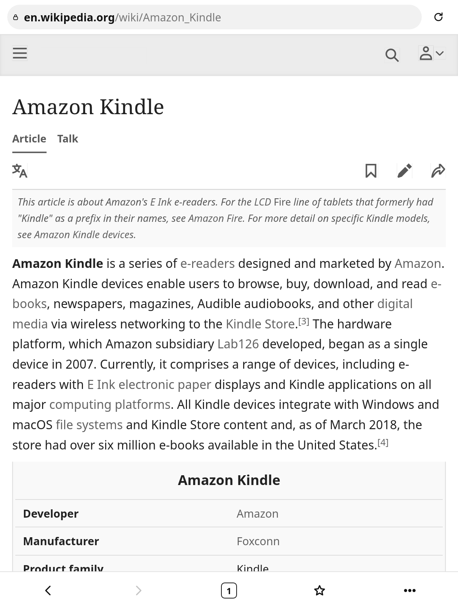
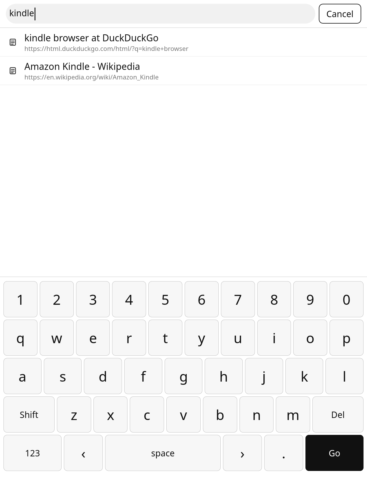
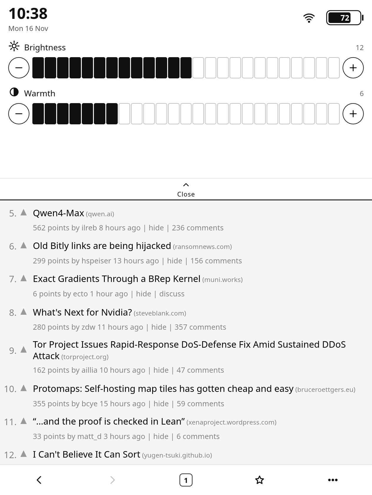
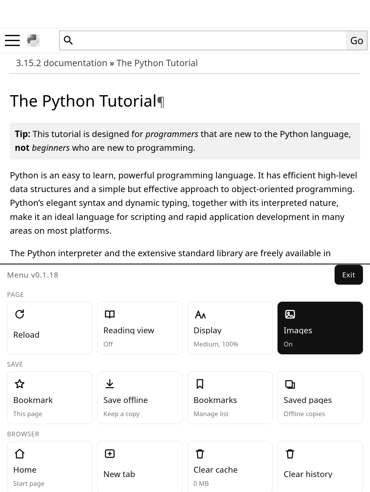
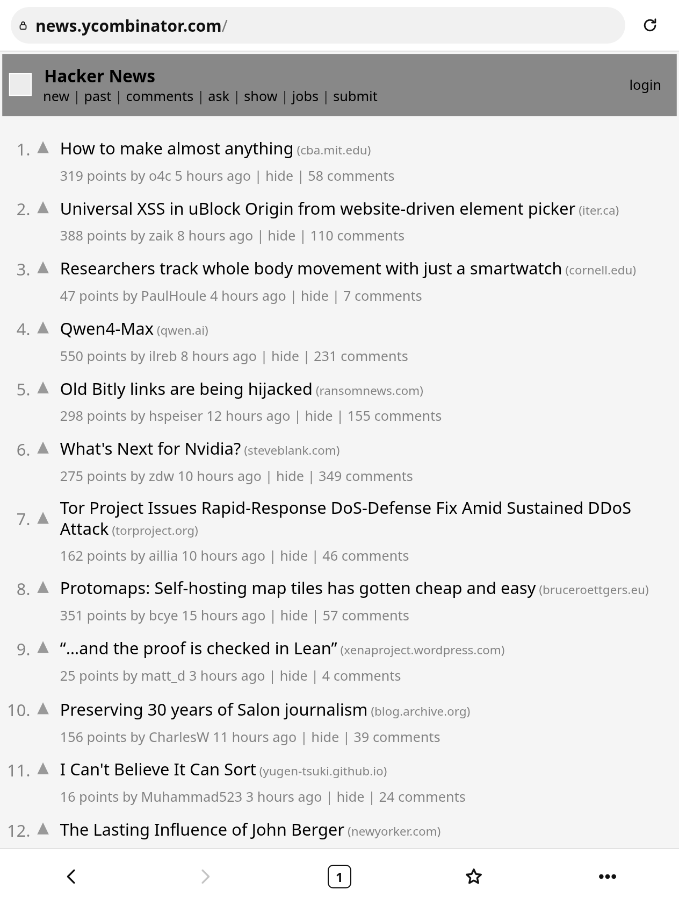
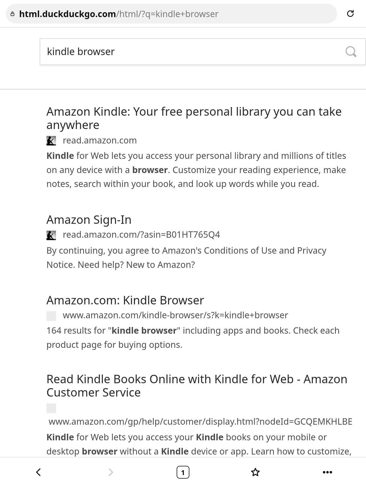
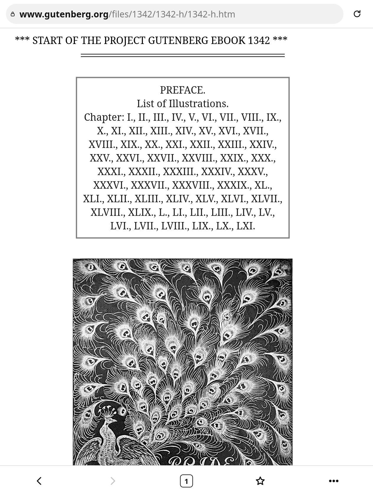

<div align="center">


# Primitive Browser

**A web browser for jailbroken Kindle e-readers.**
Written in Rust. It runs on the Kindle itself, and the screen is grayscale e-ink.

[](https://github.com/DoanNguyenTrong/kindle-primitive-browser/actions/workflows/ci.yml)
[](https://github.com/DoanNguyenTrong/kindle-primitive-browser/releases)
[](https://github.com/DoanNguyenTrong/kindle-primitive-browser/tags)
[](LICENSE)
[](https://github.com/DoanNguyenTrong/kindle-primitive-browser/stargazers)

[**Download**](https://github.com/DoanNguyenTrong/kindle-primitive-browser/releases/latest) ·
[**Install guide**](docs/INSTALL.md) ·
[**Device support**](docs/DEVICES.md) ·
[**Changelog**](docs/CHANGELOG.md)

</div>

---

Primitive Browser lays out pages with the [Blitz](https://github.com/DioxusLabs/blitz) HTML and CSS
engine (flexbox and grid included), runs a JavaScript subset in QuickJS, and paints the result in
8-bit grayscale for the e-ink panel. Everything happens on the Kindle. You do not need a computer or a
rendering server while you browse.

<table>
  <tr>
    <td colspan="3" align="center"><br><sub>Wikipedia, Amazon Kindle article</sub></td>
  </tr>
  <tr>
    <td align="center"><br><sub>Typing a search, with suggestions</sub></td>
    <td align="center"><br><sub>Reading view</sub></td>
    <td align="center"><br><sub>Quick settings, over Hacker News</sub></td>
  </tr>
</table>

<sub>Live pages, rendered by the desktop build of the same engine. The quick settings use a demo battery (72%) and a fixed clock.</sub>

<sub>Screenshots are from the desktop build of the same engine. The quick settings preview shows
demo values (a 72% battery and a fixed clock), not a real device.</sub>

## Why this exists

The built-in browser on Kindle e-readers is the only browser most readers can reach on the device,
and it struggles with the web of today.

**The problem with the built-in browser**

- **Old engine.** It is built on WebKit code from about 2009. A [2015 Paperwhite guide](https://thorgalle.me/notes/documentation-for-the-kindle-browser)
  says the browser was already old when it was released.
- **Limited JavaScript.** "Generally, only a subset of features from ES5 are supported." Promises, arrow
  functions, `let` and `const`, classes and `for...of` are missing unless a site is transpiled
  ([source](https://thorgalle.me/notes/documentation-for-the-kindle-browser)).
- **Missing layout tools.** Flexbox and grid do not work, and `position: sticky` and `position: fixed`
  act as static ([source](https://thorgalle.me/notes/documentation-for-the-kindle-browser)).
- **Wrong viewport.** The viewport reports 1072 px wide, so most sites show as tiny desktop pages that
  must be zoomed and panned to read ([source](https://thorgalle.me/notes/documentation-for-the-kindle-browser)).
- **Slow and fragile.** Pages load slowly, and "too much media content or JS may freeze the browser"
  ([source](https://thorgalle.me/notes/documentation-for-the-kindle-browser)).
- **Fixes belong to site owners.** The documented fixes are transpiling to ES5 and adding polyfills.
  A reader cannot do that for the sites they visit.
- **Older devices are weaker.** The notes above are from a 2015 model. Community reports describe the
  built-in browser as limited ES5 with no access to device storage
  ([kindle-web-tools](https://github.com/martin-at-ipal/kindle-web-tools)). Older models are expected
  to be weaker still. This project has not measured them yet.

**Newer firmware helps, but reports differ.** Amazon has updated the browser on newer firmware, and
some modern pages now load ([Liliputing](https://liliputing.com/amazons-kindle-web-browser-is-actually-usable-now/)).
The reports disagree on how far this goes. The browser still warns about limited memory and is aimed
at simple sites.

**What this project does instead.** It runs on the Kindle itself, with a modern layout engine
(flexbox and grid), a real JavaScript engine (QuickJS), a working `fetch`, HTTPS, cookies, a disk
cache, tabs and a reading view. There is no computer, server or thin client in the loop. It is still
limited, and [Limits](#limits) says what does not work yet.

**Motivation.** The stock browser cannot run most modern sites, and the usual fixes need a computer or
a server. This project builds a browser that runs entirely on the device.

<sub>Sources: [thorgalle, Paperwhite 3 browser documentation](https://thorgalle.me/notes/documentation-for-the-kindle-browser),
[kindle-web-tools](https://github.com/martin-at-ipal/kindle-web-tools),
[Liliputing](https://liliputing.com/amazons-kindle-web-browser-is-actually-usable-now/).
Community reports vary by model and firmware. Amazon publishes no official list of the browser's limits.</sub>

### More real sites

<table>
  <tr>
    <td align="center"><br><sub>The menu, on the Python 3 documentation</sub></td>
    <td align="center"><br><sub>Hacker News</sub></td>
    <td align="center"><br><sub>DuckDuckGo results</sub></td>
  </tr>
  <tr>
    <td align="center"><br><sub>Project Gutenberg, images on</sub></td>
    <td align="center"><br><sub>Python 3 documentation</sub></td>
    <td></td>
  </tr>
</table>

## Quick start

1. **Download** `primitive-browser-<version>.zip` from the [latest release](https://github.com/DoanNguyenTrong/kindle-primitive-browser/releases/latest).
2. **Copy** the `browser` and `documents` folders onto your jailbroken Kindle, next to each other on its root.
3. **Open** *Primitive Browser* from the Kindle library.

The browser ships its own FBInk (see `assets/device/README.md`); nothing else needs to be installed on the Kindle. The full steps for
macOS, Linux and Windows are in the [install guide](docs/INSTALL.md).

## Highlights

| | |
|---|---|
| 🌐 **Real pages** | HTML and CSS with flexbox and grid. Layout width is 412, 600 or 800 CSS px. |
| 🗂️ **Tabs and history** | Each tab keeps its own history and scroll position, and tabs come back after a restart. |
| 🔀 **Redirects** | Script and meta-refresh redirects are followed, so search-result links reach their target. |
| ⌨️ **Keyboard** | An on-screen keyboard with a caret, Shift, symbols and address suggestions. |
| 📖 **Reading** | A reading view, text size from 80% to 200%, day and night, and an images switch. |
| 🔖 **Library** | Bookmarks you can reorder, recent visits, saved HTML pages and folding Home sections. |
| 🔋 **Device controls** | Quick settings from the top edge: frontlight, warmth, battery, Wi-Fi and the clock. |
| 📴 **Offline friendly** | A 200 MiB disk cache with offline fallback, and saved pages you can read later. |
| ♻️ **Gentle on the Kindle** | Returns to the Kindle library on exit, and restores the screen if the browser stops. |

## Status

| Device | Status |
|---|---|
| Kindle Oasis 3 (1264 × 1680, firmware 5.18.2) | ✅ Verified on hardware |
| Other Kindle models | 🛠️ Not supported yet. See [device support](docs/DEVICES.md) for the plan. |

**Current version: 0.2.16.** Versioning and tags are in [versioning](docs/VERSIONING.md). Hardware
observations are in [device notes](docs/device-notes.md).

## Limits

Primitive Browser is for reading and reference pages, not web apps.

**Not supported**

- Modern web apps that need ES modules (`import`), WebSockets, service workers, workers, canvas,
  WebGL, audio or video. Audio and video are not planned.
- `XMLHttpRequest`. `fetch` exists, but it runs synchronously under a Promise, so the page waits for it.
- `document.write` and full Web Components (Shadow DOM).

**Partly supported**

- **Forms:** text fields, GET and POST, Enter submits. Checkboxes, radio buttons and selects are missing.
- **Storage:** `localStorage` and `sessionStorage` are in memory and last for one page only.
- **Timers and observers:** `setInterval` runs once. `MutationObserver` and the other observers are stubs.
- **History:** `history.pushState` exists, but `popstate` and `hashchange` events are not sent.

**On the Kindle**

- Verified on the Oasis 3 only.
- `Intl` is not available in the JavaScript engine, so some pages log script errors when they format dates or numbers.
- Pages took 10 to 36 seconds to load in the logged sessions.
- Image-heavy pages use a lot of memory. Project Gutenberg's *Pride and Prejudice* peaked at 593 MB with images on, and 105 MB with images off (desktop measurement).
- A page turn takes about one second to draw.
- Peak memory reached 163 MB in one session.

See [requirements](docs/01-requirements.md) for the full list.

## Roadmap

Planned in this order. Details are in the [roadmap](docs/04-roadmap.md) and [device support](docs/DEVICES.md).

- [x] Scripts on or off per site, with `<noscript>` content shown when they are off
- [x] Complete forms: checkboxes, radio buttons, select lists, password masking, Done/Submit, and `input`/`change`/cancelable `submit` events for page scripts
- [x] Find in page: a Find button in the menu; each Find moves to the next match (the controls are the keyboard's Find key, not separate next/previous buttons)
- [x] `XMLHttpRequest` as a thin wrapper over `fetch`
- [x] `localStorage` kept per site across restarts
- [x] `popstate` on Back and Forward to an entry the page pushed (the document is not loaded again). `history.pushState` adds an entry, and the basic `MutationObserver` is done
- [ ] A timed `setInterval`: intervals fire three times while a page settles, then stop, because a timed repeat would redraw pages on e-ink
- [x] Full `matchMedia` queries (lists, `and`, `not`, size, orientation, colour scheme, pointer)
- [x] Images off by default for web pages, with alt-text placeholders (see the measurements under Limits)
- [ ] Faster page turns (about one second today). The engine takes under 1 ms per turn; the rest is painting and the e-ink update. See [docs/PERFORMANCE.md](docs/PERFORMANCE.md)
- [ ] Find what makes a large page reach 163 MB. Desktop attribution: a text page costs about 77 MB, and each image about 0.45 MB; see [docs/PERFORMANCE.md](docs/PERFORMANCE.md). The device check is still to do
- [x] A ten-page site matrix, to test these features on real sites (eight pass; results in [docs/SITE-MATRIX.md](docs/SITE-MATRIX.md))
- [ ] Device profiles for other Kindle models (see [device support](docs/DEVICES.md)). The per-model table exists with the Oasis 3 only; other models need their values read from the device
- [ ] A hardware check for each new model

### Why these are not planned

The browser is built for reading and reference pages on an e-ink screen. These features suit web apps,
so each one is left out for now.

| Feature | Why it is not planned |
|---|---|
| **ES modules (`import`)** | Most modern site code is split into modules that load each other. Supporting them needs a module loader and a dependency graph, which is a large job, and reading pages rarely need it. |
| **WebSockets** | They keep a connection open for live updates such as chat and live feeds. E-ink cannot refresh continuously, and reading pages do not need live data. |
| **Service workers** | They run in the background to cache apps and work offline. The browser keeps no background JavaScript, and its disk cache already covers offline reading. |
| **Workers** | They run JavaScript on a second thread. Each page has a 48 MiB JavaScript heap on this device, so a second context would compete with the page for scarce memory, and reading pages rarely need it. |
| **Canvas** | It draws with code, mostly for charts, maps and games. Drawing that way is slow on this CPU, and the e-ink screen refreshes too slowly for animated results. |
| **WebGL** | It draws 3D graphics on the graphics processor. The Kindle has no such processor for a browser to use. |
| **Audio** | E-readers have no speaker, so there is nothing to play sound through. |
| **Video** | Video needs many frames per second. E-ink cannot refresh that fast, and the device cannot decode it at a useful speed. |

These decisions can be reviewed if the goal changes.

<details>
<summary><b>Using the browser</b></summary>

- **Bars.** The address bar is at the top. Tap it to type, or to select the current address. The toolbar
  at the bottom has Back, Forward, tabs, bookmark and Menu.
- **Scrolling.** Swipe vertically to scroll. Swipe horizontally for Back and Forward. Swipe along the
  address bar to switch tabs. The page-turn buttons move one screen.
- **Quick settings.** Swipe down from the top edge.
- **Links.** Long-press a link to open it in a new tab.
- **Menu.** Reload, reading view, Display, Images, bookmarks, saved pages, Home, New tab, Clear cache,
  Clear history and **Exit**.
- **Exit.** Saves the tabs, restores the Kindle's status bar and opens the library.
- **Start page.** A new session opens `browser/start.txt`. Saved tabs take priority.
- **Fallback.** If the library shows a blank screen after Exit, create an empty file named
  `stop-framework` in the `browser` folder on the Kindle. The launcher then stops and restarts the
  framework instead.

Your data lives in `browser/data/`. The log is `browser/log-browser.txt`.

</details>

<details>
<summary><b>Build from source</b></summary>

Requirements: Rust (stable), the `armv7-unknown-linux-musleabihf` target,
[zig](https://ziglang.org) and [cargo-zigbuild](https://github.com/rust-cross/cargo-zigbuild). The
commands below use the Homebrew Rust installation on macOS.

```sh
export PATH="/opt/homebrew/opt/rustup/bin:/opt/homebrew/bin:$PATH"
cargo build --release --workspace                                      # desktop build and tests
cargo zigbuild --release -p kb-kindle --target armv7-unknown-linux-musleabihf
scripts/package-release.sh                                             # dist/primitive-browser-<version>.zip
```

To install a build directly onto a mounted Kindle, run `sh deploy/install.sh`. To build, bump the
patch version and install in one step, run `scripts/build-device.sh`. Each such run is a new
development version. See [versioning](docs/VERSIONING.md).

</details>

<details>
<summary><b>Tests and CI</b></summary>

```sh
cargo test --workspace                       # unit tests, including device-driver logic
cargo build --release -p kb-desktop
scripts/desktop-regression.sh                # 86 desktop scenarios with screenshots (--network adds live sites)
scripts/launcher-stub-test.sh                # 10 launcher checks with stub commands
scripts/test-all.sh                          # every check, with evidence in artifacts/REPORT.md
```

The [CI workflow](.github/workflows/ci.yml) runs the unit tests, the launcher checks, the desktop
regression and the ARMv7 build on every push and pull request. The
[release workflow](.github/workflows/release.yml) builds and publishes the package when a `v*` tag is
pushed.

Desktop results are not hardware results. Hardware checks are in
[test and validation](docs/03-test-and-validation.md).

</details>

<details>
<summary><b>Project structure</b></summary>

```text
crates/kb-net       HTTP, cookies, disk cache, blocking, resource loading
crates/kb-engine    HTML/CSS layout (Blitz), scripts, grayscale paint, hit testing, forms, reader view
crates/kb-js        QuickJS and the native DOM bridge, with the browser-side prelude
crates/kb-app       Browser state, tabs, history, storage, shared UI, keyboard, quick settings
crates/kb-desktop   Stdin-driven desktop driver that writes PNG frames (testing)
crates/kb-kindle    Device driver: touch and page buttons (evdev), FBInk display, device controls
deploy/             Device launcher (Browser.sh) and installer (install.sh)
scripts/            Build, package, test and CI helpers
tests/fixtures/     Local test pages and fixture server
assets/             Fonts and icons
vendor/             Patched rquickjs-sys and blitz-dom sources for the ARMv7 build
docs/               Requirements, architecture, test plan, roadmap, UI guide, device notes, install guide
spike/              Early experiments (not part of the build)
```

</details>

## Documentation

- 📘 [Install on a Kindle](docs/INSTALL.md)
- 🏷️ [Versioning and releases](docs/VERSIONING.md)
- 📱 [Device support and the plan for other Kindles](docs/DEVICES.md)
- 🔬 [Device notes from hardware testing](docs/device-notes.md)
- 📚 [Requirements](docs/01-requirements.md) · [Architecture](docs/02-architecture.md) ·
  [Test and validation](docs/03-test-and-validation.md) · [Roadmap](docs/04-roadmap.md) ·
  [UI and UX](docs/05-ui-ux.md)
- 📝 [Changelog](docs/CHANGELOG.md) · 🤝 [Contributing](CONTRIBUTING.md)

## Contributing

Issues and pull requests are welcome. Read [contributing](CONTRIBUTING.md) first. Device changes need a
hardware test on the Oasis 3, and a note of the result in the pull request.

## Licence

Copyright (C) 2026 Doan Nguyen.

- **Code** (`crates/`, `deploy/`, `scripts/`, `tests/`): the [PolyForm Noncommercial License 1.0.0](LICENSE). You may
  use, change and share it for any non-commercial purpose. Commercial use needs the author's written permission.
- **Documentation and pictures** (this README, `docs/`, the icons and pictures in `assets/`):
  [CC BY-NC-SA 4.0](LICENSE-DOCS).
- **Earlier versions**: releases 0.1.19 to **0.2.16** were published under the GNU Affero General Public License v3.0
  (AGPL-3.0), and releases up to 0.1.18 under the MIT licence; those releases stay available under them. The new
  licences apply from the next version.

Third-party parts keep their own licences: the shared crates in `tools/` (AGPL-3.0 or PolyForm Noncommercial 1.0.0, taken
here under PolyForm Noncommercial), the vendored crates in `vendor/` and the Rust dependencies under their own licences
(among them MPL-2.0 for the Stylo CSS engine, whose files stay under MPL-2.0), FBInk under GPL-3.0
(`assets/device/licenses/`), and the Noto Sans fonts under the SIL Open Font License.

## Security

Report security problems privately to the maintainer rather than in a public issue.

