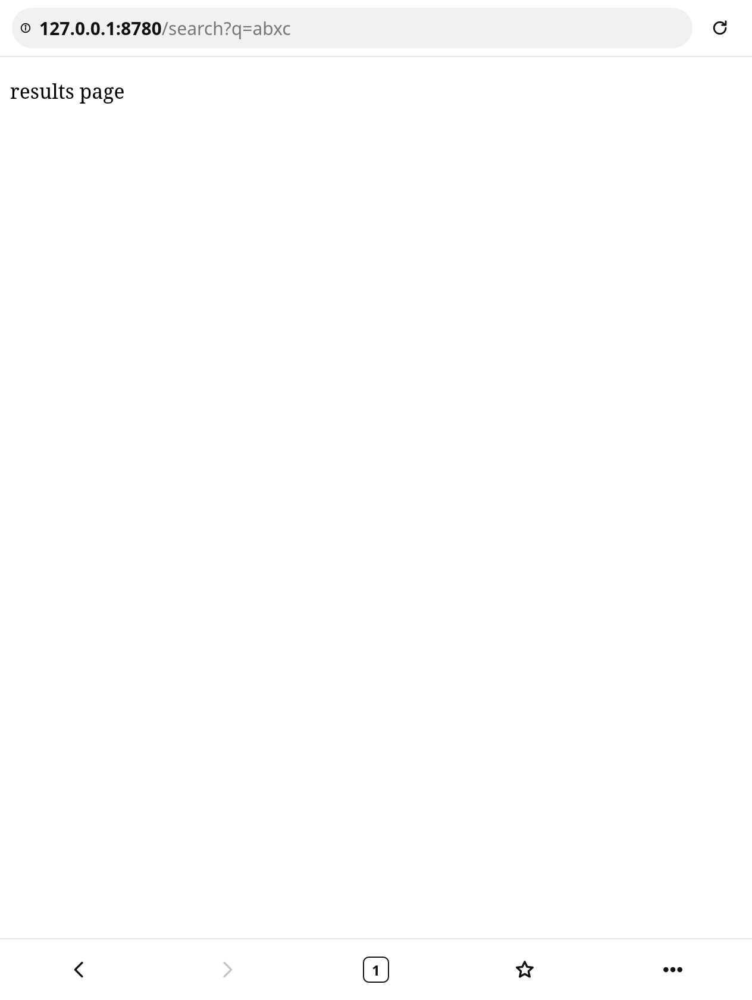
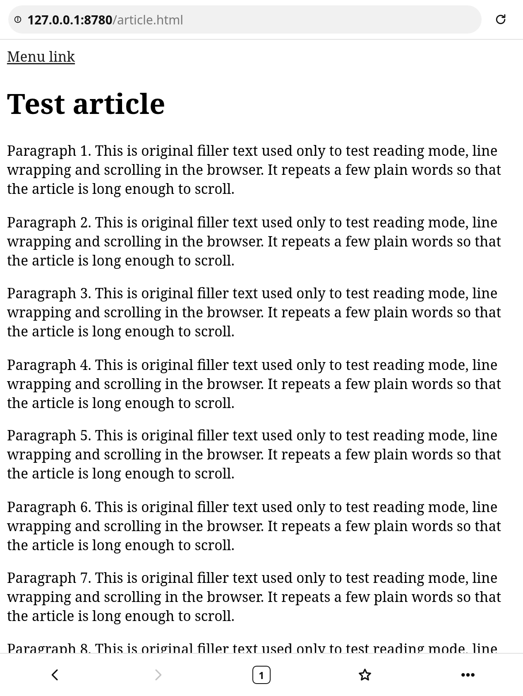
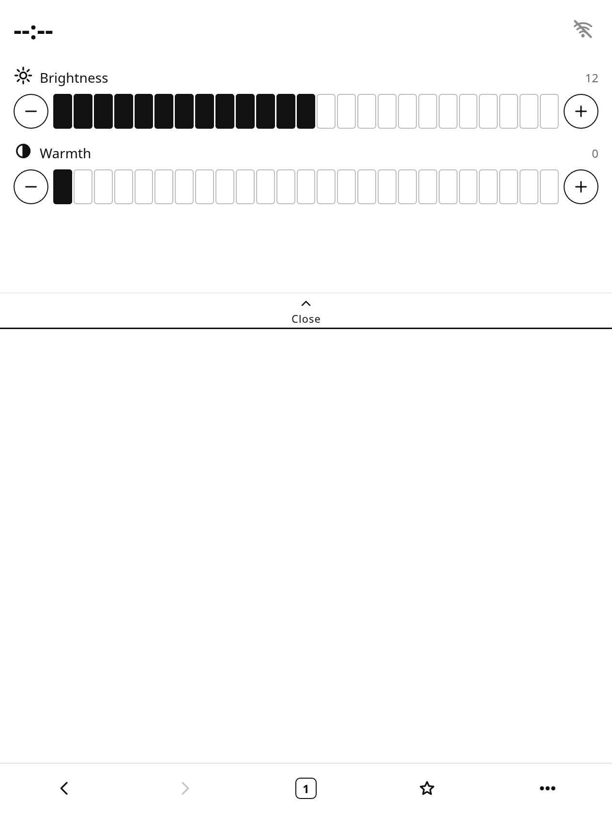

<div align="center">


# Primitive Browser

**A web browser for jailbroken Kindle e-readers.**
Written in Rust. It runs on the Kindle itself, and the screen is grayscale e-ink.

[](https://github.com/DoanNguyenTrong/kindle-primitive-browser/actions/workflows/ci.yml)
[](https://github.com/DoanNguyenTrong/kindle-primitive-browser/releases)
[](https://github.com/DoanNguyenTrong/kindle-primitive-browser/tags)
[](LICENSE)
[](https://github.com/DoanNguyenTrong/kindle-primitive-browser/stargazers)

[**Download**](https://github.com/DoanNguyenTrong/kindle-primitive-browser/releases/latest) ·
[**Install guide**](docs/INSTALL.md) ·
[**Device support**](docs/DEVICES.md) ·
[**Changelog**](docs/CHANGELOG.md)

</div>

---

Primitive Browser lays out pages with the [Blitz](https://github.com/DioxusLabs/blitz) HTML and CSS
engine (flexbox and grid included), runs a JavaScript subset in QuickJS, and paints the result in
8-bit grayscale for the e-ink panel. Everything happens on the Kindle. You do not need a computer or a
rendering server while you browse.

<table>
  <tr>
    <td colspan="3" align="center"></td>
  </tr>
  <tr>
    <td align="center"><br><sub>On-screen keyboard</sub></td>
    <td align="center"><br><sub>Reading view</sub></td>
    <td align="center"><br><sub>Quick settings</sub></td>
  </tr>
</table>

<sub>Screenshots are from the desktop build of the same engine. The quick settings preview shows
placeholder values, not a real battery.</sub>

## Quick start

1. **Download** `primitive-browser-<version>.zip` from the [latest release](https://github.com/DoanNguyenTrong/kindle-primitive-browser/releases/latest).
2. **Copy** the `browser` and `documents` folders onto your jailbroken Kindle, next to each other on its root.
3. **Open** *Primitive Browser* from the Kindle library.

You need FBInk at `/mnt/us/libkh/bin/fbink`, which KOReader and KPM provide. The full steps for
macOS, Linux and Windows are in the [install guide](docs/INSTALL.md).

## Highlights

| | |
|---|---|
| 🌐 **Real pages** | HTML and CSS with flexbox and grid. Layout width is 412, 600 or 800 CSS px. |
| 🗂️ **Tabs and history** | Each tab keeps its own history and scroll position, and tabs come back after a restart. |
| ⌨️ **Keyboard** | An on-screen keyboard with a caret, Shift, symbols and address suggestions. |
| 📖 **Reading** | A reading view, text size from 80% to 200%, day and night, and an images switch. |
| 🔖 **Library** | Bookmarks you can reorder, recent visits, saved HTML pages and folding Home sections. |
| 🔋 **Device controls** | Quick settings from the top edge: frontlight, warmth, battery, Wi-Fi and the clock. |
| 📴 **Offline friendly** | A 200 MiB disk cache with offline fallback, and saved pages you can read later. |
| ♻️ **Gentle on the Kindle** | Returns to the Kindle library on exit, and restores the screen if the browser stops. |

## Status

| Device | Status |
|---|---|
| Kindle Oasis 3 (1264 × 1680, firmware 5.18.2) | ✅ Verified on hardware |
| Other Kindle models | 🛠️ Not supported yet. See [device support](docs/DEVICES.md) for the plan. |

**Current version: 0.1.17.** Versioning and tags are in [versioning](docs/VERSIONING.md). Hardware
observations are in [device notes](docs/device-notes.md).

## Limits

The JavaScript runtime supports a subset of the browser APIs. ES modules, XMLHttpRequest,
WebSockets, workers, canvas, WebGL, audio and video are not available, and `fetch` blocks under its
Promise. Web storage is in memory. Modern web apps will not work. See
[requirements](docs/01-requirements.md) for the full list.

<details>
<summary><b>Using the browser</b></summary>

- **Bars.** The address bar is at the top. Tap it to type, or to select the current address. The toolbar
  at the bottom has Back, Forward, tabs, bookmark and Menu.
- **Scrolling.** Swipe vertically to scroll. Swipe horizontally for Back and Forward. Swipe along the
  address bar to switch tabs. The page-turn buttons move one screen.
- **Quick settings.** Swipe down from the top edge.
- **Links.** Long-press a link to open it in a new tab.
- **Menu.** Reload, reading view, Display, Images, bookmarks, saved pages, Home, New tab, Clear cache,
  Clear history and **Exit**.
- **Exit.** Saves the tabs, restores the Kindle's status bar and opens the library.
- **Start page.** A new session opens `browser/start.txt`. Saved tabs take priority.
- **Fallback.** If the library shows a blank screen after Exit, create an empty file named
  `stop-framework` in the `browser` folder on the Kindle. The launcher then stops and restarts the
  framework instead.

Your data lives in `browser/data/`. The log is `browser/log-browser.txt`.

</details>

<details>
<summary><b>Build from source</b></summary>

Requirements: Rust (stable), the `armv7-unknown-linux-musleabihf` target,
[zig](https://ziglang.org) and [cargo-zigbuild](https://github.com/rust-cross/cargo-zigbuild). The
commands below use the Homebrew Rust installation on macOS.

```sh
export PATH="/opt/homebrew/opt/rustup/bin:/opt/homebrew/bin:$PATH"
cargo build --release --workspace                                      # desktop build and tests
cargo zigbuild --release -p kb-kindle --target armv7-unknown-linux-musleabihf
scripts/package-release.sh                                             # dist/primitive-browser-<version>.zip
```

To install a build directly onto a mounted Kindle, run `sh deploy/install.sh`. To build, bump the
patch version and install in one step, run `scripts/build-device.sh`. Each such run is a new
development version. See [versioning](docs/VERSIONING.md).

</details>

<details>
<summary><b>Tests and CI</b></summary>

```sh
cargo test --workspace                       # unit tests, including device-driver logic
cargo build --release -p kb-desktop
scripts/desktop-regression.sh                # 67 desktop scenarios with screenshots (--network adds live sites)
scripts/launcher-stub-test.sh                # 10 launcher checks with stub commands
scripts/test-all.sh                          # every check, with evidence in artifacts/REPORT.md
```

The [CI workflow](.github/workflows/ci.yml) runs the unit tests, the launcher checks, the desktop
regression and the ARMv7 build on every push and pull request. The
[release workflow](.github/workflows/release.yml) builds and publishes the package when a `v*` tag is
pushed.

Desktop results are not hardware results. Hardware checks are in
[test and validation](docs/03-test-and-validation.md).

</details>

<details>
<summary><b>Project structure</b></summary>

```text
crates/kb-net       HTTP, cookies, disk cache, blocking, resource loading
crates/kb-engine    HTML/CSS layout (Blitz), scripts, grayscale paint, hit testing, forms, reader view
crates/kb-js        QuickJS and the native DOM bridge, with the browser-side prelude
crates/kb-app       Browser state, tabs, history, storage, shared UI, keyboard, quick settings
crates/kb-desktop   Stdin-driven desktop driver that writes PNG frames (testing)
crates/kb-kindle    Device driver: touch and page buttons (evdev), FBInk display, device controls
deploy/             Device launcher (Browser.sh) and installer (install.sh)
scripts/            Build, package, test and CI helpers
tests/fixtures/     Local test pages and fixture server
assets/             Fonts and icons
vendor/             Patched rquickjs-sys and blitz-dom sources for the ARMv7 build
docs/               Requirements, architecture, test plan, roadmap, UI guide, device notes, install guide
spike/              Early experiments (not part of the build)
```

</details>

## Documentation

- 📘 [Install on a Kindle](docs/INSTALL.md)
- 🏷️ [Versioning and releases](docs/VERSIONING.md)
- 📱 [Device support and the plan for other Kindles](docs/DEVICES.md)
- 🔬 [Device notes from hardware testing](docs/device-notes.md)
- 📚 [Requirements](docs/01-requirements.md) · [Architecture](docs/02-architecture.md) ·
  [Test and validation](docs/03-test-and-validation.md) · [Roadmap](docs/04-roadmap.md) ·
  [UI and UX](docs/05-ui-ux.md)
- 📝 [Changelog](docs/CHANGELOG.md) · 🤝 [Contributing](CONTRIBUTING.md)

## Contributing

Issues and pull requests are welcome. Read [contributing](CONTRIBUTING.md) first. Device changes need a
hardware test on the Oasis 3, and a note of the result in the pull request.

## Licence

Released under the [MIT licence](LICENSE). Copyright (c) 2026 Doan Nguyen.

## Security

Report security problems privately to the maintainer rather than in a public issue.

